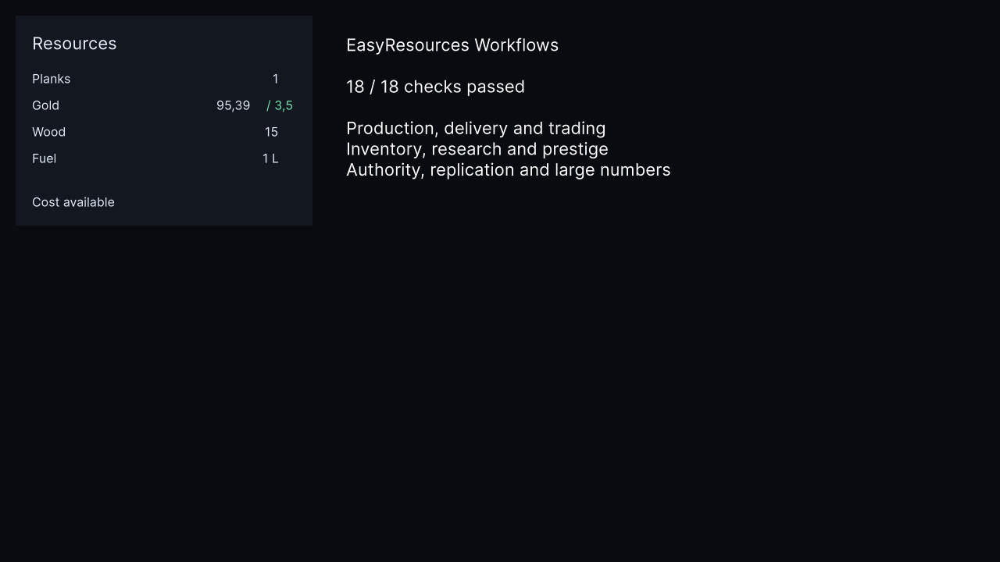

# Проверка EasyResources 0.2

Проверено 12 ноября 2026 года на Unity **6000.3.22f1**, Windows x64, Mono, Intel Core i7-14700KF. Публикация в Git не выполнялась.

## Функциональные проверки

| Среда | Результат | Отчёт |
|---|---|---|
| Чистый проект, установка локального UPM-пакета | 98/98 EditMode | [JSON](Reports/v2-clean-editmode.json) |
| Чистый проект, компоненты и UI | 7/7 PlayMode | [JSON](Reports/v2-clean-playmode.json) |
| Минимальный проект без UI Toolkit и Pipeline | 97/97 EditMode; UI-сборка отсутствует | [XML](Reports/v2-no-ui-editmode.xml) |
| Импортированный Basics | 13/13 сценариев | [JSON](Reports/v2-clean-basics.json) |
| Импортированный Workflows | 18/18 сценариев | [JSON](Reports/v2-clean-workflows.json) |
| Workflows в Windows Development Player | 18/18; UI отрисован и осмотрен | [JSON](Reports/v2-workflows-player.json) |
| Ассет Wood из 0.1 | Исходный ID сохранён; точность 0, вес/объём 1 | [JSON](Reports/v2-legacy-asset.json) |
| Профилировочная сборка | Успешно, 0 предупреждений и ошибок сборки | [JSON](Reports/v2-benchmark-build.json) |
| Установка упакованного UPM tarball | LocalTarball 0.2.0; 98 EditMode + 7 PlayMode; готовая Workflows 18/18 без создания сцены вручную | [Установка](Reports/v2-clean-install-tarball-status.json), [тесты](Reports/v2-tarball-tests.json), [PlayMode](Reports/v2-tarball-play.json), [сцена](Reports/v2-tarball-workflows-result.json) |
| Player без UI Toolkit / Pipeline, из tarball | Сборка: 0 ошибок/предупреждений; запуск: баланс 10 → 7, сохранение/восстановление версии 2 | [Сборка](Reports/v2-no-ui-build.json), [запуск](Reports/v2-no-ui-player.json) |

В минимальном проекте проверялась предыдущая ревизия кандидата из 97 тестов; итоговый набор добавляет проверку вызова ResourceBatch из чужого потока. Затем в том же минимальном проекте из итогового tarball собран и запущен отдельный Player. UI Toolkit и Pipeline отсутствовали в manifest, сборка EasyResources.UI не подключалась. Пакет остаётся пригодным для логики экономики без UI.

Проверки охватывают отказы без частичного списания, ограничения и переполнение, перевод между кошельками, согласованность событий, частичные и восстановленные резервы, миграции, очередь целых операций, производство и блокировку выхода, точные скорости, доставки, цены и налоги, кредит, предметы, ранги и исследования, повторные/поддельные/устаревшие команды, потерю истории, дельты, большие числа и уничтожение компонентов из уведомлений. Случайная последовательность из 300 операций дополнительно сравнивает быстрые одиночные операции с общей ResourceTransaction по остаткам, резервам, ревизиям, событиям и журналу.

Проверка компонентов восстанавливает кошелёк, производственную станцию и исследование и подтверждает, что старые объекты не отменяют новые резервы. UI проверяется после выключения/включения и после смены источника.

В **Games Factory** установлен пакет 0.2.0: повторно прошли **98/98 EditMode**, **7/7 PlayMode**, Basics **13/13** и Workflows **18/18**. Общий проект компилируется, проверка стабильных ID не выявила конфликтов. После проверки восстановлены исходная SampleScene и выключенный Play Mode; режим runInBackground не менялся. Отчёты: [EditMode](Reports/v2-main-editmode.json), [PlayMode](Reports/v2-main-playmode.json), [Workflows](Reports/v2-main-workflows.json), [определения](Reports/v2-main-validation.json).

## Визуальная проверка

Ниже — реальный Resource Panel после выполнения Workflows. Панель отрисована Unity UI Toolkit в RenderTexture 1280×720; справа добавлена подпись проверочного стенда с фактическим числом успешных сценариев. Значения: 95,39 Gold, 15 Wood, 1 L Fuel, 1 Plank. Предпросмотр цены — 3,5 Gold. Обычный захват скрытого окна Player не предоставил изображение, поэтому использовался рендер в текстуру.



## Метод измерения

Sample **Benchmarks** запускается в Windows x64 Development Player:

```text
ResourceBenchmark.exe -batchmode -nographics -easyResourcesReport "C:/absolute/path/report.json"
```

Для ядра: 3 прогрева, затем 15 измеренных пакетов. Перед измерениями выполняется полный GC; определения, кошельки, стоимости и массивы подготавливаются заранее. На каждый кошелёк создаются одновременные резервы, проверяется отказ оплаты, половина резервов подтверждается, половина отменяется, ресурсы возвращаются, затем выполняются оплата и возврат. Каждый пакет проверяет сохранность всех остатков и отсутствие утёкших резервов. Дополнительные модули измеряются по 1000 итераций сценария, 15 пакетов, после 64 прогревов.

CPU — длительность измеряемого участка главного потока по Stopwatch. GC — события **GC.Alloc** через ProfilerRecorder с SumAllSamplesInFrame и CollectOnlyOnCurrentThread. Положительный контроль `new byte[1024]` дал **1 событие**. `GC.GetAllocatedBytesForCurrentThread()` не используется: в этом Unity Mono он возвращал 0 даже для намеренных аллокаций. Ноль событий означает ноль выделенных байтов; для выделяющих сценариев отчёт содержит число событий, а размер помечен `-1`.

`managedSetupBytes` — приблизительная разница управляемой памяти до подготовки и после прогрева/GC. Она включает кошельки, стоимости, дескрипторы и вспомогательные массивы стенда. Это не точный размер одного контейнера. Другие Unity-процессы работали на том же компьютере; абсолютные значения и сравнение с историческим 0.1 зависят от нагрузки системы.

## Ядро: CPU, память, GC

Стоимость переиспользуется; время в миллисекундах за полный пакет.

| Сценарий | Кошельки / типы / строки стоимости / резервы на кошелёк | Медиана 0.1 | Медиана 0.2 | P95 0.2 | Подготовленная память 0.2 | GC |
|---|---|---:|---:|---:|---:|---:|
| typical-small | 32 / 2 / 2 / 2 | 0,0684 | 0,1786 | 0,2357 | 0,09 MiB | 0 B |
| typical-large | 2000 / 2 / 2 / 2 | 7,3762 | 11,2984 | 11,4600 | 3,57 MiB | 0 B |
| heavy-small | 128 / 16 / 8 / 16 | 9,3131 | 11,1889 | 11,3405 | 0,56 MiB | 0 B |
| heavy-large | 10000 / 16 / 8 / 16 | 617,5384 | 874,6952 | 879,5297 | 47,41 MiB | 0 B |

Последний сценарий создаёт **160000 одновременных резервов** и выполняет более миллиона API-вызовов за пакет. Такую нагрузку распределяют между кадрами; ResourceBatch ограничивает число целых операций, но не дробит одну транзакцию.

Первый расширенный вариант выполнял heavy-large за 3871,7848 мс и использовал около 75,75 MiB подготовленной памяти. Специализированные одиночные операции, отложенное создание общего транзакционного буфера и метаданных резерва сократили время примерно в **4,4 раза**, память — примерно на **37%**. Версия 0.2 хранит больше состояния и выполняет больше проверок, чем 0.1; исторические результаты приведены полностью, без утверждения об одинаковой стоимости версий.

При создании новой ResourceCost на каждой итерации ядро ожидаемо выделяет память: от 4320 до 1350000 событий GC.Alloc за 15 пакетов в зависимости от масштаба. Частый путь должен переиспользовать подготовленные стоимости.

## Модули

Медиана за **1000 итераций**; количество действий внутри итерации определяется сценарием.

| Сценарий | Медиана, мс | GC-событий за 15 пакетов |
|---|---:|---:|
| Перевод туда и обратно | 7,5012 | 0 |
| Резерв, частичная оплата, изменение, отмена и возврат | 2,6206 | 0 |
| Постановка и завершение производства | 4,1687 | 0 |
| Два противоположных потока ресурсов | 7,7616 | 0 |
| Покупка и продажа по подготовленным котировкам | 12,9733 | 0 |
| Добавление и удаление из стака | 3,8964 | 0 |
| Покупка ранга и престиж | 5,6778 | 0 |
| Сетевая команда и возврат средств | 6,2460 | 105000 |
| BigInteger: расход и возврат | 11,3027 | 270000 |

Сетевые DTO/ответы и BigInteger выделяют память намеренно. Гарантия 0 B не распространяется на создание объектов и уникальных предметов, рост буферов, подготовку стоимости, снимки, миграции, изменение подписок и форматирование UI. Resource Panel объединяет события за кадр и обновляет текст один раз в LateUpdate.

Исходные результаты: [0.2 после оптимизации](Reports/v2-benchmark-optimized.json), [0.2 до оптимизации](Reports/v2-benchmark-before-optimization.json), [исторический 0.1](Reports/benchmark-clean-final.json).

## Повторение установки

В новом проекте Unity 6000.3 установите пакет с диска, импортируйте Basics через Package Manager, откройте поставляемую сцену и нажмите Play: ожидается 13 PASS. Затем импортируйте Workflows, откройте поставляемую ResourceWorkflows.unity: ожидается 18 PASS и панель ресурсов. Путь samples содержит версию `0.2.0`. Для API-тестов добавьте пакет в `testables` и установите Unity Test Framework 1.6.0. Для собственного ввода используйте Unity Input System (New).
